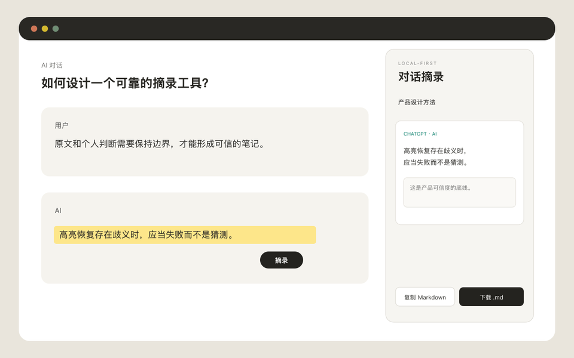
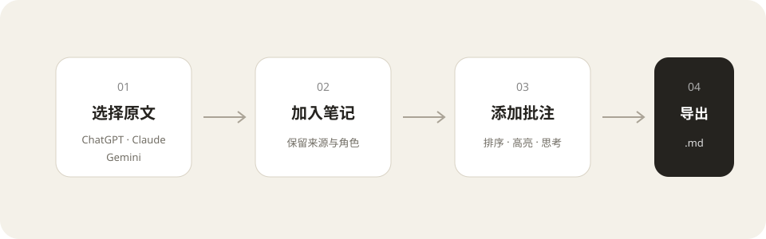

# 对话摘录 Dialogue Clipper

一个本地优先的 Chrome 扩展：从 ChatGPT、Claude 和 Gemini 选择原文、添加自己的批注，用对话图与摘录图定位长对话，并导出可长期保存的 Markdown 笔记。

> v0.1 不总结、不润色，也不上传你的对话。原文是证据，批注属于你。





## 功能

- 在单条 AI 消息内选中文字，通过浮动按钮或快捷键摘录。
- 将三个平台的片段整理到同一个主题笔记中。
- 保存来源平台、对话标题、角色、时间和原始链接。
- 点击摘录卡片可切回来源对话，并滚动到对应原文位置。
- 支持摘录 ChatGPT、Claude 与 Gemini 生成的研究报告正文（包括全屏报告、成果视图和 Canvas）。
- 对话导航图按网页当前可见路径展示“我 / AI”消息，支持搜索、当前阅读位置跟随和单击跳回网页。
- 对话节点显示关联摘录数量，可一键切换到对应摘录图；摘录图节点也能反向定位到对话消息。
- 摘录卡片可建立父子连接；导图采用 React Flow + Dagre，支持节点拖动、画布平移、缩放、自动布局、拖线改层级及双击返回原文。
- 在侧栏添加批注、拖拽排序、切换四种高亮颜色。
- 刷新页面后尽力恢复高亮；无法唯一定位时绝不猜测。
- 实时预览、复制或下载“原文证据型” Markdown。
- 所有数据只保存在 `chrome.storage.local`，没有账号、后端、遥测或第三方分析。

## 支持范围

| 平台 | 域名 | v0.1 |
| --- | --- | --- |
| ChatGPT | `chatgpt.com` | 支持 |
| Claude | `claude.ai` | 支持 |
| Gemini | `gemini.google.com` | 支持 |

目标浏览器为 Chrome 116+。暂不支持普通网页、图片、附件、整页剪藏、云同步、AI 总结及 Firefox/Safari。

## 安装

### 下载 Release

从 GitHub Releases 下载 `dialogue-clipper-0.1.0-chrome.zip`，解压后打开 `chrome://extensions`：

1. 开启右上角“开发者模式”。
2. 点击“加载已解压的扩展程序”。
3. 选择解压目录。
4. 在 ChatGPT、Claude 或 Gemini 打开一条对话，点击扩展图标打开侧栏。

Chrome Web Store 上架后，本节会补充商店链接。

### 从源码构建

要求 Node.js 20+：

```bash
npm install
npm run build
```

然后在 `chrome://extensions` 加载 `.output/chrome-mv3`。运行开发模式：

```bash
npm run dev
```

## 使用

1. 在侧栏创建一个主题笔记。
2. 在支持的 AI 对话中选择一段文字。
3. 点击选区旁的“摘录”，或按快捷键：Windows/Linux 为 `Alt+Shift+S`，macOS 为 `Control+Shift+S`。
4. 回到侧栏写批注、调整顺序和颜色。
5. 打开“导航”：用“对话图”浏览长对话，或用“摘录图”整理保留的重点。
6. 在 Markdown 页签预览，复制或下载 `.md` 文件。

若还没有当前笔记，摘录会进入本地待分配队列，创建或选择笔记后自动归档，不会丢失。

## 数据与隐私

- 只持久化用户主动选择的文字，不保存整段对话。
- 对话图会在支持站点中临时读取当前页面已加载、可见路径的消息文本；数据只在扩展运行内存中用于绘图，不写入存储、不上传。
- 摘录、批注和笔记只存于当前 Chrome 配置的扩展本地空间。
- 扩展没有服务器，不发出内容请求，不收集使用数据。
- 卸载扩展会删除这些本地数据；卸载前请下载 Markdown 备份。
- 本地空间接近 Chrome 默认约 10 MB 配额的 80% 时，侧栏会提示导出清理。

完整说明见 [PRIVACY.md](PRIVACY.md)。

## 高亮为何可能失效

三个 AI 网站都是会持续改版的单页应用。扩展依次尝试消息标识与偏移、原文加前后文、页面消息唯一匹配。若页面结构改变、原消息被编辑或同样文字出现多次，扩展会显示“未能重新定位”，而不会把高亮标到错误位置。摘录原文及批注仍可查看和导出。

对话图同样是尽力读取能力：它展示网页当前已经加载的活动路径，不调用站点私有接口，也不捕获登录凭据，因此不会伪装成完整的隐藏分支树。切换原站分支后，图会随页面重新生成。

## 开发与验证

```bash
npm run typecheck
npm test
npm run build
npm run zip
```

站点相关 DOM 逻辑位于独立适配器中，脱敏固件位于 `tests/fixtures`。网站改版时应只修改相应适配器并更新其测试固件。

## 项目结构

```text
entrypoints/
  background.ts         消息路由、快捷键与侧栏唤起
  content.ts            选区按钮、高亮恢复与临时对话图扫描
  sidepanel/            React 侧栏界面
lib/
  adapters/             ChatGPT / Claude / Gemini 适配器
  anchors.ts            文本锚点与安全定位
  conversation-graph.ts 对话图快照、摘录关联与歧义保护
  storage.ts            版本化本地数据和写入队列
  markdown.ts           Markdown 输出与未来转换接口
tests/                  单元测试和脱敏 DOM 固件
```

## 参与贡献

欢迎提交站点适配修复、可复现的错误报告和无障碍改进。请先阅读 [CONTRIBUTING.md](CONTRIBUTING.md) 与 [CODE_OF_CONDUCT.md](CODE_OF_CONDUCT.md)。

## License

[MIT](LICENSE) © Dialogue Clipper contributors
